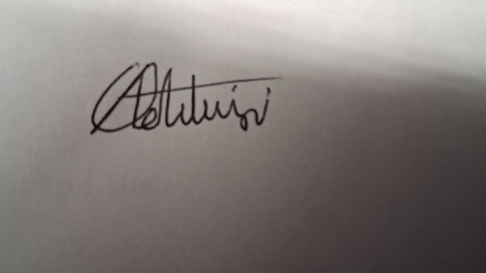

# CONDUCT.md

*305Soft Team Code of Conduct \- CSC 305 Agile/Scrum Project*

---

## Our Pledge

We as members, contributors, and leaders of this CSC 305 Agile/Scrum team pledge to make participation in our team a harassment-free, respectful, and inclusive experience for everyone, regardless of age, body size, visible or invisible disability, ethnicity, sex characteristics, gender identity and expression, level of experience, education, socio-economic status, nationality, personal appearance, race, caste, color, religion, or sexual identity and orientation.

We pledge to act and interact in ways that contribute to an open, welcoming, diverse, inclusive, and healthy team environment where all members feel psychologically safe to contribute, learn, and grow together.

---

## Our Standards

### Examples of Behavior That Contributes to a Positive Team Environment

* **Demonstrating empathy and kindness** toward all team members, including during code reviews, technical discussions, and feedback.  
* **Being respectful of differing opinions, viewpoints, and experiences**—recognizing that diverse perspectives strengthen our solutions.  
* **Giving and gracefully accepting constructive feedback** in pull requests, standups, retrospectives, and 1-on-1s without defensiveness.  
* **Accepting responsibility and apologizing** to those affected by our mistakes; viewing errors as learning opportunities, not shameful events.  
* **Focusing on what is best for the overall team and project**, not just individual interests or completion speed.  
* **Active listening** during all team meetings; giving others full attention and not interrupting.  
* **Assuming good intent** when interpreting others' words or actions; asking clarifying questions before reacting negatively.  
* **Honoring the 305Soft policy** of no distracted use of technology (phones away, meeting-focused applications only) during all team meetings.  
* **Being punctual and reliable**; respecting others' time by arriving on time and completing commitments.  
* **Supporting team members' learning and growth**; offering mentorship, pair programming, and knowledge sharing without gatekeeping expertise.  
* **Celebrating wins together**—acknowledging individual contributions, sprint achievements, and team progress.

### Examples of Unacceptable Behavior

* **The use of sexualized language or imagery**, and sexual attention or advances of any kind.  
* **Trolling, insulting, or derogatory comments**, including sarcasm used to demean others; personal or political attacks.  
* **Public or private harassment** of any team member, including during meetings, in Slack/Discord, or via email.  
* **Publishing others' private information** (e.g., personal email, phone number, home address) without explicit permission.  
* **Passive-aggressive communication** (e.g., sarcastic comments about someone's code, dismissive tone in reviews).  
* **Exclusionary behavior** such as ignoring certain team members, leaving them out of discussions, or deliberately not inviting them to meetings.  
* **Blaming or shaming** team members for mistakes or incomplete work instead of problem-solving together.  
* **Violating the 305Soft no-distracted-technology policy** by using phones, non-meeting apps, or multitasking during team meetings.  
* **Dismissing or minimizing** others' ideas, concerns, or contributions; gatekeeping knowledge or intentionally withholding help.  
* **Other conduct which could reasonably be considered inappropriate in a professional or academic setting**, including disrespect toward the team's Scrum Master, Product Owner, or instructor.

---

## 305Soft Policy: No Distracted Use of Technology During Team Meetings

**All team members must put phones away and close non-meeting-related applications during all team meetings, standups, planning sessions, retrospectives, and ad-hoc discussions.** Laptops should be used only for meeting-related tasks (note-taking, screen sharing, documentation, Github Kaban updates). This policy is mandatory per CSC 305 course requirements and supports focus, psychological safety, and collective ownership of sprint goals.

**Consequences for violating this policy are outlined in the Enforcement Guidelines section below.**

---

## Enforcement Responsibilities

The **Scrum Master** are responsible for clarifying and enforcing these standards of acceptable behavior. They will take appropriate and fair corrective action in response to any behavior deemed inappropriate, threatening, offensive, or harmful.

**Scrum Master have the right and responsibility to:**

* Remove, edit, or reject comments, commits, code, pull request reviews, Github Kaban updates, and other contributions not aligned with this Code of Conduct.  
* Communicate reasons for moderation decisions when appropriate.  
* Facilitate private conversations to address concerns and resolve conflicts.  
* Escalate serious violations to the instructor when necessary.

---

## Scope

This Code of Conduct applies within all team spaces, including:

* **In-person meetings** (class, project course and pre-planned in person meetings)  
* **Virtual meetings** (Zoom)  
* **Asynchronous communication** (email, GitHub, Group chat)  
* **Code repositories and pull requests** (GitHub, including commit messages, review comments)  
* **Project documentation** (Github kanban, shared google documenents)

This Code of Conduct also applies when an individual is **officially representing the team** in public spaces (e.g., class presentations, stakeholder demos, project expos).

---

## Decisions

### How Will They Be Made?

**Primary Method: Consensus**

* We aim for decisions that all team members can support, even if not their first choice.  
* Discussion continues until we reach alignment or near-alignment.  
* All perspectives are heard and considered before moving forward.

**Fallback: Majority Vote**

* If consensus cannot be reached after reasonable discussion (15+ minutes of active dialogue), we move to a simple majority vote.  
* The Scrum Master facilitates to ensure all voices are heard before voting.  
* Voting results and dissenting perspectives are documented in meeting minutes.

**Escalation: Product Owner/Instructor**

* For decisions affecting product scope, timeline, or course requirements, the Product Owner or instructor has final authority after gathering team input.  
* All stakeholders are informed of the decision and rationale.

**Documentation:** All significant decisions are recorded in meeting minutes with rationale and dissenting perspectives, shared within 24 hours.

---

## Attendance

### What Are Your Expectations for the Frequency and Type of Attendance?

* All team members **must attend all scheduled sprint ceremonies** (Planning, Daily Standup, Review, Retrospective) and **all required team meetings.**  
* Expected attendance frequency: **100% for ceremonies**; unavoidable absences require **24-hour advance notice** to the Scrum Master.  
* Being "present" means actively engaging—not just physically showing up, but contributing meaningfully to discussions.

### What Are Legitimate Reasons for Missing?

* Illness (personal or family emergency)  
* University-sanctioned obligations (exams, required events, field trips)  
* Documented personal emergencies  
* Pre-approved time-sensitive work conflicts (with Scrum Master approval)  
* University-excused absence (verified with Dean of Students)

### What Do Missing Members Have to Do to Make Up for Missed Meetings?

* **Missed Standups:** Review meeting minutes and Group chat summary; communicate status to Scrum Master within 24 hours.  
* **Missed Planning/Review/Retro:** Meet 1-on-1 with Scrum Master to be brought up to speed; review recording/notes before the next ceremony.  
* **Missed Multiple Meetings:** After 2 unexcused absences per sprint, the Scrum Master initiates a conversation to understand blockers.  
* **Chronic Absences:** Three or more unexcused absences may affect participation grade and sprint contribution assessment per CSC 305 policies.

---

## Assignments

### How Will Assignments Be Made?

* During **Sprint Planning**, the team collectively discusses work items and individuals **volunteer for tasks** based on skill level, capacity, and learning goals.  
* The Scrum Master and Product Owner facilitate to ensure **balanced workload**, equitable learning opportunities, and skill development.  
* **Acceptance criteria** are clearly defined; estimated story points are recorded.  
* Assignments are tracked in Github Kaban with due dates, ownership, and progress status.

### How Will the Group Deal with Members Who Do Not Complete or Poorly Complete Assignments?

**Tier 1: Early Identification & Support**

* **Daily standups** surface blockers immediately. If someone is struggling, the team offers support (pair programming, code review, mentoring, resource sharing).  
* **Blocker resolution:** Scrum Master removes impediments or escalates to Product Owner/instructor if external help is needed.

**Tier 2: Mid-Sprint Adjustment**

* If work is going poorly or behind schedule, the Scrum Master \+ assignee \+ relevant team members discuss:  
  * Was the estimate unrealistic?  
  * Are there technical blockers?  
  * Does the assignee need upskilling or different support?  
* **Action:** Reassign subtasks, pair with a mentor, extend deadline, or break the work into smaller pieces—**without blame**.

**Tier 3: Missed Deadlines**

* Scrum Master \+ assignee have a **private 1-on-1 conversation** to identify root cause (unrealistic estimate, unexpected blocker, health/personal issue, lack of clarity).  
* **Collaborative problem-solving:** Adjust sprint capacity, offer pairing, provide additional resources, or rescope the task.  
* Document the conversation and agreed-upon path forward.

**Tier 4: Quality Issues (Code Review)**

* **Peer code review** catches quality issues. Reviewer and author collaborate to improve code without personal criticism.  
* **Framing:** *"This logic could be clearer if we…"* not *"Your code is confusing."*  
* Scrum Master documents patterns and raises them in retrospective for process improvement.

**Tier 5: Persistent Non-Completion** (2+ instances per sprint)

* Scrum Master initiates a **structured 1-on-1 feedback conversation** to identify what's needed:  
  * Is this a skill gap? Offer training or pair programming.  
  * Is workload unbalanced? Redistribute tasks.  
  * Are there personal challenges? Connect to campus resources or adjust commitments.  
  * Is motivation low? Discuss team fit and expectations.  
* **If issues persist after 2 sprints:** Escalate to instructor with documentation; may affect participation grade.

**Tone:** All conversations prioritize psychological safety and learning. Mistakes are reframed as opportunities to strengthen team processes.

---

## Participation

### How Will You Communicate and Share Information?

**Primary Channels:**

* **Synchronous:** Zoom for ceremonies and real-time technical discussions.  
* **Asynchronous:** Group chat for daily updates, questions, and non-urgent discussion.  
* **Project tracking:** Github kaban for task status, blockers, and sprint progress.  
* **Code & documentation:** GitHub for code, pull requests, wikis, and technical decisions.

**Weekly Digest:**

* Scrum Master sends a **2-minute sprint snapshot** (completed items, in-progress work, upcoming blockers) to keep everyone aligned.  
* Shared in Group Chat and team meeting minutes.

### How Will You Ensure Full Participation of Everyone? 

* **Round-robin speaking** in retrospectives, planning, and brainstorming sessions to ensure all voices are heard, not just the loudest.  
* **Async input option:** Team members can contribute written feedback to the Scrum Master 24 hours before meetings if they prefer or have scheduling conflicts.  
* **No interrupting:** One person speaks at a time. Scrum Master gently redirects if conversations become dominated or chaotic.  
* **Psychological safety:** Frame mistakes, questions, and exploratory ideas as learning opportunities; celebrate questions in retrospectives.  
* **Quiet members:** Scrum Master explicitly invites input: *"\[Name\], what do you think about this approach?"* or *"We'd love to hear your perspective."*  
* **Dominant voices:** Gently redirect after 2-3 minutes: *"Great points—let's hear from others too."*

### How Will You Honor Member Strengths and Interests?

* During **Sprint Planning**, ask team members:  
  * *"What skills do you want to grow this sprint?"*  
  * *"What area excites you or aligns with your career goals?"*  
  * *"Where do you feel confident and where do you want support?"*  
* **Pair experienced members with those learning** (e.g., backend expert mentoring on Firebase setup).  
* **Rotate responsibilities:** Different team members lead demos, take sprint notes, facilitate standups, and own different technical areas to build well-rounded skills.  
* **Document expertise:** Create a skills matrix in the wiki so the team knows who to turn to for guidance.

---

## Meeting Times and Locations/Mediums

### How Will You Decide on Locations and Times That Suit All Members?

**Decision Process:**

* Primary meetings will be held in the course and project section ( Monday 4-5:45,  Tuesday 9:30-10:45, Thursday 9:30-10:45).   
* If extra meetings are needed, time to do so will be facilitated in the group chat.

**Meeting Mediums:**

* **Preferred:** In-person for collocated teams (lecture and project course) for better engagement and relationship-building.  
* **Hybrid/Remote:** Zoom recordings and shared notes.  
* **Inclusive:** All meetings are recorded and notes/summaries are shared within 24 hours for asynchronous catch-up.  
* **Accommodations:** If a team member cannot make a fixed time (due to accessibility needs, documented conflicts, time zone), discuss:  
  * Rotating meeting times across sprints, or  
  * Async participation options (recorded input, written updates, staggered involvement)

---

## Agenda and Minutes/Notes

### Who Will Take Them and How Will They Be Shared?

**Agenda Creation:**

* **Scrum Master** prepares a **loose agenda** (5-7 bullets) and shares it **24 hours before the meeting** in the Group Chat.  
* Team members can **add items** to a "parking lot" list if something urgent arises.  
* **Estimated time** for each agenda item helps keep discussions focused.

**Note-Taking & Responsibility:**

* **The Scrum Master will take responsibility of the notes.** 

* **Shared within 24 hours** in a shared document (Google Doc).  
    
* **Visibility:** Notes are accessible to all team members and the instructor.

**Accountability:**

* Scrum Master reviews notes for completeness and clarity; flags any ambiguous action items for clarification.  
* Team members review notes and add actions that were missed.  
* Action items are moved to Github Kaban Boards by end of day.  
* During the next standup, action items are briefly reviewed for progress.

---

## Promptness

### What Do You Expect?

* **On-time arrival:** Team members arrive/log in **exactly at the scheduled time** for all meetings.  
* **Grace period:** 5-minute technical buffer for connectivity issues; anything beyond is considered late.  
* **Respect for group time:** Meetings start on time regardless of latecomers; latecomers are briefed after the meeting, not during.

### How Will You Handle Lateness?

**First Occurrence:**

* Scrum Master mentions it casually with no blame: *"Hey, just a heads-up—let's try to get here by 2 PM next time so we can respect everyone's schedules."*

**Pattern (2+ late arrivals per sprint):**

* Scrum Master initiates a **private 1-on-1 conversation** to understand the root cause:  
  * Time zone confusion?  
  * Calendar clash with another class?  
  * Transportation/accessibility issue?  
  * Notification/reminder not working?  
* **Problem-solve together:** Adjust meeting time, set calendar reminders, or provide other support.  
* Document the conversation.

**Chronic Lateness (3+ incidents per sprint):**

* Escalated in a respectful manner to the team and instructor.  
* Discussed in retrospective: *"Our meetings are starting late—how can we support punctuality as a team?"*  
* May affect final participation grade per CSC 305 policies.

---

## Conversational Courtesies

### How Will the Team Encourage and Reinforce Active Listening, Sharing of Airtime, Tangents, and Respectful Dialogue?

**Active Listening & Respectful Dialogue:**

* **One speaker at a time.** Scrum Master gently redirects if two people talk over each other: *"Let's let \[Name\] finish, then \[Other Name\], I'd love to hear your perspective."*  
* **No side conversations** during meetings. If you need to comment, raise it to the group or save it for after the meeting.  
* **Assume good intent.** When interpreting others' words or actions, assume they meant well; ask clarifying questions before reacting negatively.  
* **Disagreements are about ideas, not people.** Separate the proposal from the proposer: *"I'm not sure that approach will work because…"* not *"You're wrong."*  
* **Ask clarifying questions** before debating: *"Can you help me understand why you chose that pattern?"* rather than *"That's wrong because…"*

**Sharing Airtime:**

* **Quiet members:** Scrum Master explicitly invites input: *"\[Name\], what do you think about this approach?"* or *"We haven't heard from you yet—any thoughts?"*  
* **Dominant voices:** Gently cap after 2-3 minutes: *"Great points—let's hear from the team on this too."*  
* **Round-robin in Retrospectives:** Go around the circle/Zoom grid; each person gets 2 minutes uninterrupted to share reflections or concerns.

**Managing Tangents:**

* **Parking lot rule:** Off-topic but important ideas go to a "parking lot" list written on a whiteboard or shared document.  
* **Revisit parking lot items:** At the end of the meeting or in a separate discussion thread in Group chat.  
* **Scrum Master's role:** *"That's a great point—let's capture it in the parking lot and discuss it after standup so we stay on track."*

**Feedback Culture:**

* **Feedback is framed as observations, not attacks.**  
    
  * ✅ *"I noticed our code reviews are taking 2 days—could we aim for 24-hour turnaround?"*  
  * ❌ *"You're slow at reviewing, and it's blocking our sprint."*

* **Feedback in retrospectives is a safe space:** Focus on behaviors and outcomes, not personalities.  
    
  * ✅ *"This sprint, our testing coverage dropped to 60%. What blockers did we hit?"*  
  * ❌ *"\[Member\], you didn't write enough tests."*

* **Use the "SBI" feedback model:** Situation → Behavior → Impact  
    
  * *"When we merged code without tests (situation), it broke the API (behavior/impact). Next sprint, let's pair on testing before merging."*

---

## Enforcement & Feedback

### How Will the Team Enforce Its Own Rules?

**Step 1: Self-Regulation (First Instance)**

* Team members remind each other in a friendly, informal way.  
* Example: *"Hey, looks like phones are out—let's put them away so we can stay focused."*  
* No shame or blame; framed as a gentle nudge to keep the team aligned.

**Step 2: Scrum Master Escalation (Repeated Behavior)**

* After informal reminders fail (or for serious violations), the **Scrum Master raises it in a private 1-on-1** to:  
  * Understand the blocker (distraction, forgetfulness, genuine need to be reachable?)  
  * Reset expectations clearly and kindly  
  * Offer support if needed  
* Document the conversation and agreed-upon path forward.

**Step 3: Peer Accountability (Team Level)**

* In **retrospectives**, the team can raise concerns about adherence to the Code of Conduct:  
  * *"We're struggling with late arrivals—how do we fix this together?"*  
  * *"Our code reviews don't feel respectful sometimes. How can we improve?"*  
* Frame as **collective problem-solving**, not shaming.

**Step 4: Formal Enforcement** (Serious or Repeated Violations)

* Follows the Enforcement Guidelines below (Correction → Warning → Temporary Ban → Permanent Ban).  
* Escalated to the **instructor** with documentation.  
* May affect participation/professionalism grades per CSC 305 policies.

### How Do Individuals Prefer to Give and Receive Feedback?

**Frequency:**

* **Weekly informal check-ins:** Scrum Master touches base with individuals about progress, blockers, and general well-being.  
* **Formal feedback:** End-of-sprint retrospectives (as a team) and regular 1-on-1s (individual).

**Format:**

* **For individuals:** 1-on-1 with Scrum Master (private, constructive, documented).  
* **For the team:** Group retrospective (focus on process, not blame; psychological safety required).

**Tone:**

* Curious and supportive: *"I want to help you succeed."*  
* Growth-oriented: *"Here's what I noticed—how can we improve together?"*  
* Respectful: No sarcasm, dismissiveness, or personal attacks.

**Timeliness:**

* Address minor issues **same week** so they don't fester.  
* Save patterns for **sprint retrospectives** for team-wide reflection and adjustment.

**Giving Feedback Process (Team Framework):**

1. **Ask permission:** *"Can I share some feedback?"*  
2. **Use SBI model:**  
   * **Situation:** *"In standup today, I noticed…"*  
   * **Behavior:** *"…when you interrupted while I was explaining the API design…"*  
   * **Impact:** *"…it made me feel rushed, and we didn't fully discuss the approach."*  
3. **Request or offer support:** *"Could you try asking questions instead of jumping in?"* or *"What support do you need?"*  
4. **Listen and collaborate:** Be open to their perspective; it may not have been intentional.  
5. **Agree on next steps:** *"Next time, let's both pause and ask clarifying questions first."*

**Receiving Feedback Process:**

1. **Listen without defensiveness.** Assume good intent; they want to help, not attack.  
2. **Ask clarifying questions:** *"Can you give me an example of when this happened?"*  
3. **Take time to process.** You don't have to agree immediately, but acknowledge their perspective.  
4. **Thank them:** *"I appreciate the feedback. Let me think about how I can improve."*  
5. **Follow up:** Show that you took their feedback seriously by making adjustments and reporting back.

---

## Enforcement Guidelines

The Scrum Master and Product Owner will follow these **Community Impact Guidelines** in determining consequences for violations of this Code of Conduct. The goal is **growth and accountability**, not punishment.

---

### 1\. Correction

**Community Impact:** Use of inappropriate language, minor unprofessional behavior, or conduct deemed unwelcome in the community. Examples:

* Single instance of distracted use of technology during a meeting.  
* Mildly dismissive comment during a code review.  
* One late arrival without advanced notice.

**Consequence:**

* **Private, written warning or 1 on 1 chat** from the Scrum Master providing:  
  * Clarity around the nature of the violation  
  * Explanation of why the behavior was inappropriate  
  * Expectations going forward  
* **Public apology may be requested** if the behavior affected the team (at Scrum Master's discretion).  
* **Documentation:** Scrum Master notes this in their records; not reported to instructor unless it becomes a pattern.

**Timeline:** Addressed within 24-48 hours of the incident.

---

### 2\. Warning

**Community Impact:** A violation through a single serious incident or series of actions that show a pattern. Examples:

* Repeated distracted use of technology (3+ instances).  
* Continued late arrivals despite first conversation.  
* Dismissive or disrespectful comments toward a teammate in meetings or PRs.  
* Single instance of excluding someone from a meeting or discussion.  
* Violating confidentiality (sharing private team discussions publicly).

**Consequence:**

* **Formal warning** from the Scrum Master with a clear written summary of:  
  * What behavior needs to change  
  * Why it's unacceptable  
  * Specific, measurable expectations  
  * Support offered to help them succeed  
* **No interaction with involved parties** (if applicable) for a specified period without explicit permission from the Scrum Master.  
* **Avoid unsolicited interaction** with those enforcing the Code of Conduct during the probation period.  
* Avoiding interactions in community spaces (team meetings, Group Chats, GitHub) and external channels.  
* **Violation of warning terms** may lead to temporary or permanent removal from the team.  
* **Documented and reported to the instructor** with the team's recommended next steps.

**Timeline:** Warning issued within 24 hours. Probation period: typically 1-2 sprints (1-3 weeks), reviewed in next retrospective.

---

### 3\. Temporary Ban

**Community Impact:** A serious violation of community standards, including sustained inappropriate behavior or severe misconduct. Examples:

* Harassment of a teammate (repeated exclusion, targeted criticism, mockery).  
* Sexualized language or imagery shared with the team.  
* Intentional sabotage of a teammate's work or reputation.  
* Aggressive or threatening communication.  
* Persistent violations after a formal warning.  
* Violation of the 305Soft no-distracted-technology policy repeated 5+ times.

**Consequence:**

* **Temporary removal from team participation** for a specified period (typically 1-2 weeks, defined by instructor and Scrum Master).  
* **No public or private interaction** with team members, including Slack, email, GitHub, or in-person meetings.  
* **No unsolicited interaction** with those enforcing the Code of Conduct during the ban.  
* **Violation of ban terms** automatically escalates to a permanent ban.  
* **Escalated to the instructor immediately** with full documentation.  
* **Grade impact:** Temporary suspension may affect final participation grade; determined by instructor per CSC 305 policies.

**Timeline:** Ban begins immediately after notification. Review after specified period to assess readiness for reinstatement.

---

### 4\. Permanent Ban

**Community Impact:** Demonstrating a persistent pattern of violations, sustained inappropriate behavior, harassment, aggression, or disparagement of a team member or class of individuals. Examples:

* Continued violations after temporary ban.  
* Severe harassment or threat against a teammate.  
* Discriminatory behavior based on identity (race, gender, sexual orientation, disability, etc.).  
* Intentional, repeated harm to team cohesion or a specific individual.  
* Extreme unprofessionalism or disrespect toward instructor or team leadership.

**Consequence:**

* **Permanent removal from the team** and exclusion from all team spaces (meetings, Group Chats, GitHub, shared documents).  
* **Escalated to the instructor and appropriate university authorities** (Dean of Students, etc.).  
* **Significant grade impact:** Determined by instructor; may result in course failure or other disciplinary action per university policy.  
* **No appeal process** within the team; appeals handled through university judicial channels if applicable.

---

## Resolution Process for Serious Incidents

If a team member reports a violation that feels serious (harassment, discrimination, safety concern), the process is:

1. **Report to Scrum Master** (or directly to instructor if the Scrum Master is the accused).  
2. **Private investigation:** Scrum Master \+ Product Owner interview all involved parties and relevant witnesses within 48 hours.  
3. **Documentation:** Detailed notes of all statements, evidence, and findings.  
4. **Escalation:** Immediately escalated to the instructor with full documentation.  
5. **Resolution:** Instructor and Scrum Master determine consequences per guidelines above; student may have right to appeal through university channels.  
6. **Privacy:** Confidentiality of the reporter is maintained; accused is informed of allegation but not the reporter's identity (unless required by university policy).

---

## Reporting a Violation

**If you experience or witness a violation of this Code of Conduct:**

1. **Immediate safety concern?** Contact campus security or the instructor immediately.  
2. **Harassment, discrimination, or threat?** Report to the Scrum Master, Product Owner, or instructor.  
3. **Minor concern?** Speak informally with the person first if you feel safe doing so; if unresolved, escalate to Scrum Master.

**Report Details to Include:**

* What happened (specific incident)  
* Who was involved  
* When it occurred  
* Who witnessed it (if applicable)  
* Impact on you or the team  
* Any documentation (screenshots, emails, etc.)

**Confidentiality:** Your privacy will be respected. Information is shared only with those who need to know to address the concern.

**No Retaliation:** The team is committed to ensuring no retaliation occurs against anyone who reports a violation in good faith.

---

## Contact Information

**Scrum Master:** \[Team member name\] – \[Email address\]

**Product Owner:** \[Product Owner name\] – \[Email address\]

**Instructor:** \[Dr./Prof. Name\] – \[Email address\]

**Course:** CSC 305 Agile/Scrum

For urgent concerns outside business hours or if the Scrum Master/instructor is unavailable, contact:

* **Campus Security:** (401) 874-4910 \- uripd@etal.uri.edu  
* **Dean of Students:** (401) 874-2098 \- deanofstudents@uri.edu

---

## Scope & Applicability

This Code of Conduct applies to all team members, the Scrum Master, Product Owner, and instructor during CSC 305 Agile/Scrum coursework and related team activities. It remains in effect for the duration of the course and any team-related interactions (whether in-class, after-class, or after the course ends).

---

## Review & Updates

This Code of Conduct will be reviewed and refined during the **first sprint retrospective**. Team members may propose amendments based on:

* Emerging needs or gaps  
* Lessons learned from team dynamics  
* Feedback from violations or conflicts

**Changes require team consensus and instructor approval.**

---

## Sign-Off & Signatures

By signing below, all team members acknowledge that they have read, understood, and agree to uphold this Code of Conduct for the duration of the CSC 305 project.

**Each team member has committed their signature to this document via individual commits to ensure accountability and authenticity.**

---

### Team Member Signatures

#### Scrum Master/Team Member 1: \[Name\]

**Commit Date:** \[Date\]

---

#### Team Member 2: OgoOluwa Adetunji

</img>
  
**Commit Date:** 10/15/2026

---

#### Team Member 3: \[Name\]

**Commit Date:** \[Date\]

---

#### Team Member 4: \[Name\]

**Commit Date:** \[Date\]

---

## Document Version & History

| Version | Date | Changes | Approved By |
| :---- | :---- | :---- | :---- |
| 1.0 | \[Date\] | Initial Code of Conduct created for CSC 305 Team | Team & Scrum Master |

---

## Attribution

This Code of Conduct is adapted from the [**Contributor Covenant**](https://www.contributor-covenant.org)**, version 2.1**, available at [https\://www\.contributor-covenant.org/version/2/1/code\_of\_conduct.html](https://www.contributor-covenant.org/version/2/1/code_of_conduct.html), and tailored for academic team collaboration.

Community Impact Guidelines were inspired by [**Mozilla's code of conduct enforcement ladder**](https://github.com/mozilla/diversity).

For questions about this Code of Conduct, see the [**Contributor Covenant FAQ**](https://www.contributor-covenant.org/faq).

---

**Last Updated:** \[10/13/2026\]

---

## Instructions for Team Members

### How to Add Your Signature

1. **Write your signature** on a piece of paper by hand  
2. **Take a clear photo** of your signature  
3. **Upload the image** to your personal Google Drive  
4. **Make the image shareable** with a public link (Anyone with the link can view)  
5. **Copy the shareable link** and embed it in this document using the markdown format below:

\!\[Your Name Signature\](https\://your-google-drive-link-here)  
